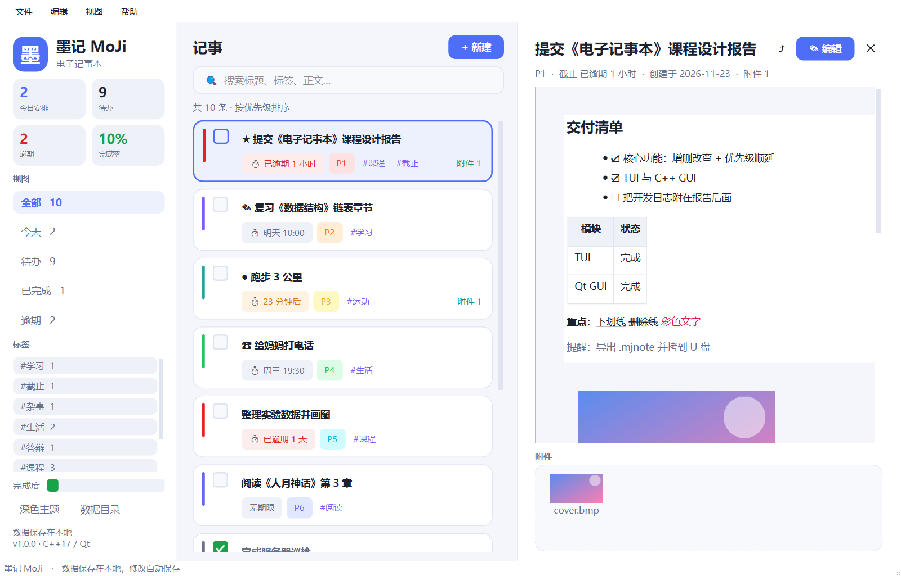
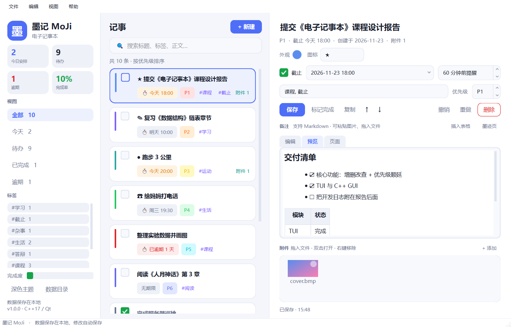
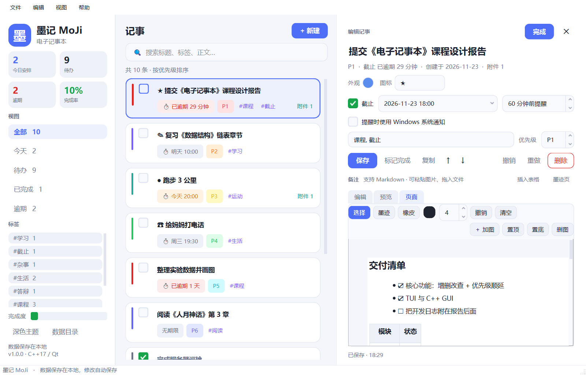
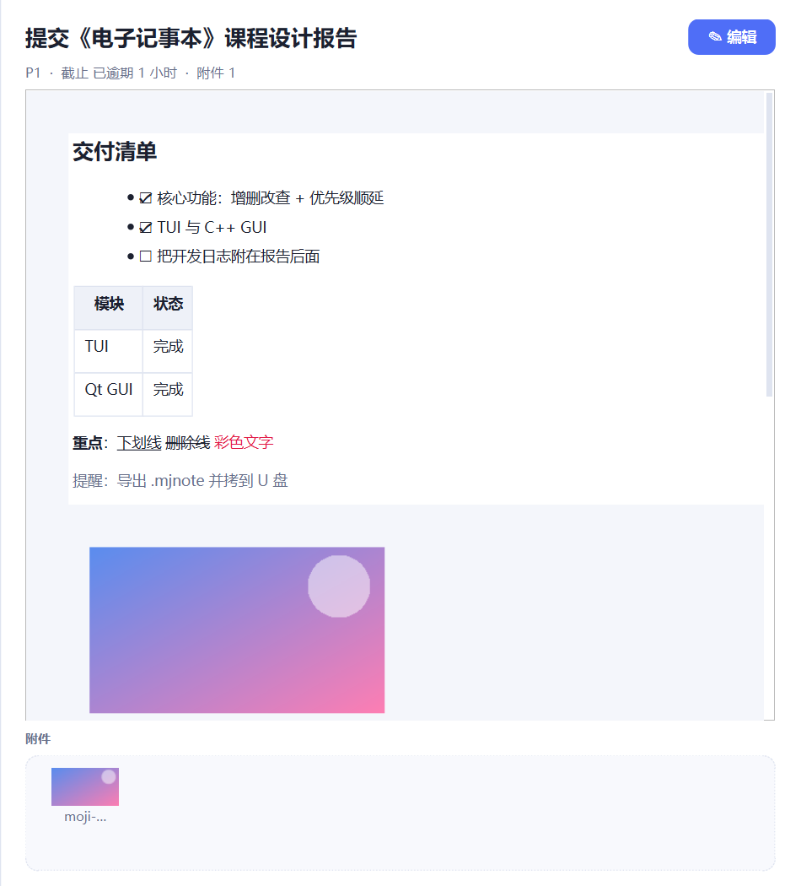
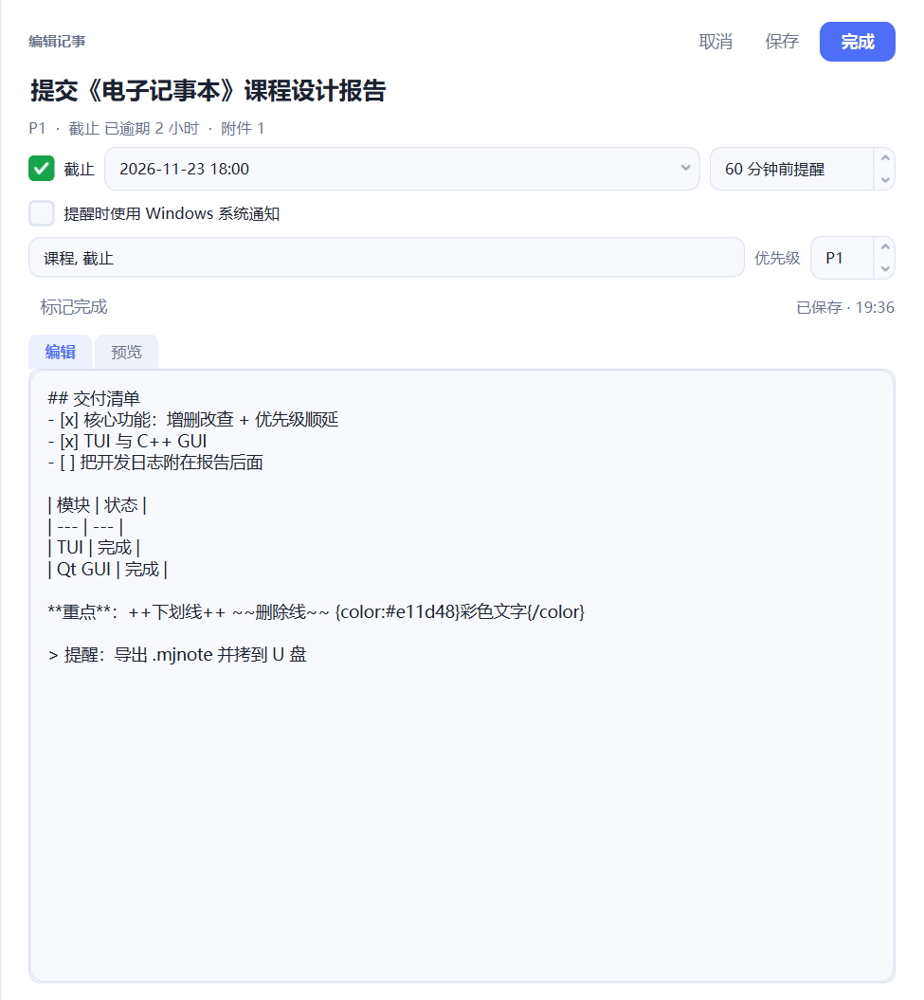
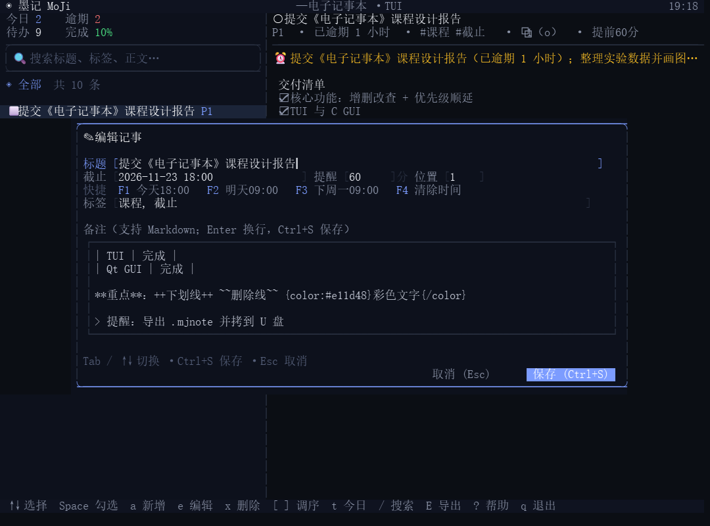

# 墨记 MoJi · 电子记事本（C++17）

> 课程设计《电子记事本的实现》主实现：**C++17 + 单向优先级链表 + UTF-8 文本存储 + 控制台 TUI + Qt6 Widgets 图形界面**。
>
> 仓库内另有：
> - `c_legacy/`：C89 单文件基础版（菜单循环 + 链表 + 文本文件 + 蜂鸣）。
> - `python_prototype/`：开发早期的 Python 原型（含 40 项测试），不参与本次 C++ 提交，保留作对照。



| 深色 GUI | 控制台 TUI |
| --- | --- |
|  |  |

| Markdown 预览 | 页面（墨迹 / 图片层） |
| --- | --- |
|  |  |

| 页面拖出为独立窗口 | 独立窗口内编辑 |
| --- | --- |
|  |  |

| TUI 模态编辑表单 |
| --- |
|  |

> 多选、主题色与自定义图标效果见 [`docs/gui-multi.png`](docs/gui-multi.png)。

---

## 目录

- [功能](#功能)
- [构建与运行](#构建与运行)
- [使用](#使用)
- [数据与存储](#数据与存储)
- [设计](#设计)
- [测试](#测试)
- [C89 基础版](#c89-基础版)
- [Python 原型](#python-原型)
- [已知限制](#已知限制)
- [第三方库](#第三方库)

---

## 功能

### 基础要求

| 要求 | C++ 实现 |
| --- | --- |
| 输入待办、当天安排提醒（蜂鸣） | TUI/GUI 启动提醒、到点/提前提醒；`MessageBeep` + 弹窗；`src/core/model.cpp::needs_reminder` |
| 修改处理时间、编辑优先级 | 编辑器改截止时间；`↑/↓`、`[`/`]`、位置输入调整 |
| 插入后优先级顺延 | `EventList::insert_at`：原第 N 位及之后所有事件 +1 |
| 删除、修改记录 | 删除确认 + 撤销；标题/备注/截止/标签/优先级全字段编辑 |
| 按时间查询当日事宜 | `Repository::due_on`、今日视图、`moji list --today/--date` |
| 显示全部或部分 | 全部/今天/待办/已完成/逾期 + 标签 + 关键字搜索 |
| 菜单、循环、界面友好 | TUI 快捷键 + 鼠标；GUI 侧边栏 + 卡片流；C 版菜单循环 |
| 文本文件存储 | `%USERPROFILE%\.moji\events.json`（UTF-8 文本）+ 附件目录 |

### 拓展功能

- **控制台 TUI**：侧边栏实时显示任务、统计、标签；内联边框搜索框；`Space` 勾选；鼠标点左侧方框勾选；模态输入表单；Markdown 表格；居中帮助面板；附件弹窗；`Ctrl+Z/Y`；到点响铃 + 提醒条。
- **Qt GUI**：Qt6 Widgets + QSS，Material 风格浅色/深色主题、卡片列表、只读页面 → 编辑两步式交互、自动保存、统计卡、标签筛选、搜索。
- **优先级直接输入**：GUI 编辑器里的「优先级 Pn」数字框、TUI 新增/编辑表单里的位置；输入目标序号即可，原位置及之后自动顺延。
- **Markdown 预览**：GUI 备注分为「编辑 / 预览 / 页面」三页；预览支持标题、列表、**粗体**、*斜体*、++下划线++、~~删除线~~、表格、`{color:#e11d48}彩色文字{/color}`、引用、代码。
- **OneNote 风格页面**：页面页可直接用鼠标画墨迹（颜色/粗细/橡皮/撤销/清空），墨迹与文字/图片一起保存，不是附件。
- **图片像图床一样嵌入**：页面页的图片可拖动、缩放、旋转、置顶/置底/删除；文字本身也是一个可移动、可调层的图层。
- **每个事项可换图标/颜色**：编辑器「外观」可修改左侧竖杠颜色和图标（emoji/字符），卡片会显示图标。
- **高度个性化**：「视图 → 设置…」可改应用名/副标题/Logo（都可留空）、正文字号、窗口不透明度、壁纸、亚克力背景、默认铃声与音量；主题色取色器为 MD 圆角色块。
- **逐事项铃声**：编辑器里可单独指定铃声，未设置则用默认铃声；支持 WAV/MP3/WMA/M4A/AAC/FLAC/OGG 等。
- **闹钟式提醒**：到点精确到秒，铃声循环播放；弹窗可「停止 / 静音 / 5 分钟后再提醒」。
- **页面图层**：置顶/置底计入墨迹层，可真正压过墨迹；墨迹层 z 值随页面保存。深色模式下纸张自动反相。
- **独立窗口编辑**：拖出的页面窗口里同样有「编辑 / 预览 / 页面」三页，可直接手写墨迹；深色模式下同样反相。
- **取消编辑**：编辑器右上角「↺」会还原到进入编辑前的快照（自动保存过也能回滚）；「✓」保存并返回。
- **Logo 编辑**：选择图片后可裁剪、缩放、平移，支持圆角/圆形/方形/六边形边框，GIF 保持动画。
- **侧栏自适应**：窗口高度不足时侧栏滚动，统计卡不再互相遮挡。
- **TUI Markdown 同步**：详情区按终端能力渲染粗体、斜体、下划线、删除线、彩色文字和代码。
- **Ctrl / Shift 连选**：GUI 列表中 Ctrl 点选、Shift 范围选择、Ctrl+Shift 追加范围；多选后可批量完成/删除。
- **附件**：拖文件进窗口即添加；图片显示缩略图；双击用系统程序打开；右键移除；支持任意文件/音频。
- **粘贴图片**：按钮读取 Windows 剪贴板图片，保存为 PNG 附件。
- **手绘笔迹**：GUI 内置画板（颜色、粗细、撤销、清空），保存为 PNG 附件。
- **表格**：菜单一键插入 Markdown 表格模板。
- **导入导出**：`.mjnote`（ZIP + 附件）、`.json`、todo.txt、Markdown。
- **提醒**：30 秒轮询，提前 N 分钟；`MessageBeep` + 弹窗；每个事项可勾选「提醒时使用 Windows 系统通知」，通过系统托盘通知中心弹出。
- **容错**：原子写入、自动备份、损坏恢复、路径穿越防护、撤销/重做、删除确认。
- **安装**：`install.ps1` 编译 → 安装到 `%LOCALAPPDATA%\MoJi\bin` → 自动写用户 PATH + 开始菜单快捷方式；终端 `moji` 默认进 TUI。

---

## 构建与运行

### 前置条件

- Windows 11（Windows 10 同样可用）
- **MSYS2 UCRT64** 的 `g++`（本机测试版本 15.2.0）、`qmake6`、`mingw32-make`、`windeployqt`，确保 `C:\msys64\ucrt64\bin` 在 PATH 中
- Qt6 与 nlohmann/json：Qt 用 MSYS2 包安装（见下），json 已随仓库提供

```bash
pacman -S --needed mingw-w64-ucrt-x86_64-qt6-base mingw-w64-ucrt-x86_64-qt6-tools
```

### 一键构建

在项目根目录打开 cmd / PowerShell：

```bat
.\build.bat
```

> 如果当前目录策略禁止直接执行当前目录程序，用 `.\build.bat` 或 `call build.bat`。

或 MSYS2 / Git Bash：

```bash
bash build.sh
```

产物：

```
build\moji.exe       控制台版：CLI / TUI / GUI（moji gui）
build\moji-gui.exe   窗口版 Qt GUI（旁边带 Qt 运行库，双击即用）
build\test_core.exe  C++ 核心测试（98 个检查）
```

### 安装到系统

**方式一：一键脚本（推荐）**

```bat
install.bat
```

脚本会先检测环境：

1. 检查 64 位 Windows、`LOCALAPPDATA`；
2. 检查 `build\` 是否已有 `moji.exe`、`moji-gui.exe`、`Qt6Core.dll`、`platforms\qwindows.dll`，有就直接安装；
3. 没有产物时检查 `g++` / `qmake6` / `mingw32-make` / `windeployqt`；
4. 缺依赖时询问是否自动安装 MSYS2 + GCC + Qt6（通过 winget + pacman，约 1 GB）；也可直接用 `install.bat -InstallDeps`；
5. 自动编译，复制程序与 Qt 运行库到 `%LOCALAPPDATA%\MoJi\bin`；
6. 写入用户 PATH，创建开始菜单快捷方式；
7. 运行 `moji.exe --version` 自检。

常用参数：

```bat
install.bat -Yes           :: 不询问，能装就装
install.bat -NoBuild       :: 只用现有 build\ 产物
install.bat -Desktop       :: 额外创建桌面快捷方式
install.bat -InstallDeps   :: 允许自动安装 MSYS2/Qt6
```

卸载：

```bat
uninstall.bat              :: 删除程序、PATH、快捷方式，保留数据
uninstall.bat -PurgeData   :: 连 %USERPROFILE%\.moji 一起删除
```

**方式二：图形安装包**

`MoJi-Setup-1.2.0.exe` 是 Inno Setup 生成的标准安装包：

- 安装到 `%LOCALAPPDATA%\Programs\MoJi`（无需管理员）；
- 自动生成 `unins000.exe` 卸载程序，并出现在「应用和功能」；
- 可选桌面快捷方式、可选加入用户 PATH；
- 包含 TUI、Qt GUI、C89 基础版、文档与截图。

重新生成安装包：

```powershell
powershell -ExecutionPolicy Bypass -File .\installer\build-installer.ps1
```

脚本会按需编译程序、调用 Inno Setup 6，并把 `MoJi-Setup-1.2.0.exe` 复制到 `D:\程序设计`。

**方式三：便携 zip**

`package.ps1` 可生成便携 zip：`dist\moji-cpp-1.2.0.zip`。

### 直接运行构建产物

```bat
build\moji.exe                       :: TUI（无参数）
build\moji.exe gui                   :: GUI
build\moji.exe -d D:\notes gui       :: 指定数据目录
build\moji-gui.exe                   :: 窗口版 GUI（读取 MOJI_HOME）
```

---

## 使用

### TUI

| 按键 | 作用 |
| --- | --- |
| `↑` `↓` | 选择任务；`PgUp/PgDn` 翻页 |
| `Space` / `d` | 勾选 / 取消；也可鼠标点左侧方框 |
| `a` | 新增：居中模态表单（标题、截止、提醒、位置、标签、多行备注） |
| `e` | 编辑：同一套模态表单（Tab/↑↓ 切换，Ctrl+S 保存，Esc 取消） |
| `F1`–`F4` | 表单内快捷时间：今天 18:00 / 明天 09:00 / 下周一 09:00 / 清除 |
| `x` / `Delete` | 删除（需确认） |
| `[` / `]` | 提高 / 降低优先级 |
| `t` / `0` / `1` / `2` / `3` | 今日 / 全部 / 待办 / 已完成 / 逾期 |
| `/` | 聚焦带边框搜索框，直接输入；Enter 确认，Esc 清空 |
| `o` | 打开附件弹窗：↑↓ 选择，Enter 打开，Del 移除，Esc 关闭 |
| `Ctrl+Z` / `Ctrl+Y` | 撤销 / 重做 |
| `E` / `I` | 导出 / 导入 |
| `T` | 重新加载 `tui-theme.json` |
| `?` | 帮助 |
| `q` | 退出 |

TUI 使用 ANSI 真彩色，在 Windows Terminal / conhost 中均可运行；建议窗口 ≥ 100×30。详情区会渲染 Markdown 表格；`?` 打开居中的帮助面板，结构与 Python 原型一致。`a` / `e` 的表单也改为居中模态窗口：


### GUI

- 左侧：统计卡、视图、标签、主题、数据目录。
- 中间：搜索、卡片流；点击卡片先打开只读页面，双击或右上角「✎ 编辑」进入编辑。
- 启动时不预读任何卡片，右侧默认收起；页面右上角 `✕` 可关闭分屏，再点卡片重新打开。
- 右侧页面：标题、元信息、OneNote 页面（Markdown 文字层、图片层、墨迹层）和附件；点「编辑」后修改，约 0.7 秒自动保存。
- 页面滚轮：直接滚 = 上下滚动；`Ctrl+滚轮` = 左右滚动；`Ctrl+Shift+滚轮` = 以鼠标位置为中心缩放。
- 页面右上角 `⤴` / 「视图 → 拖出当前页面…」可把页面拖成独立可缩放窗口；窗口里的「编辑」就在该独立窗口内打开编辑器，不再占用主窗口侧边栏。
- 编辑顶栏「完成」保存并返回页面；「提醒时使用 Windows 系统通知」可为该事项开启系统通知。
- 卡片上的「X 分钟后 / 已逾期」每 15 秒自动刷新，不再停留在打开窗口时的旧值。
- 逾期/已完成等分类为空时只显示一句「没有符合条件的记事」，不再显示新建引导和右侧分屏。
- 附件：从资源管理器拖入窗口、粘贴剪贴板图片、手绘、双击打开、右键移除。
- 菜单/快捷键：`Ctrl+N` 新建、`Ctrl+S` 保存、`Ctrl+F` 搜索、`Ctrl+Alt+Z/Y` 撤销/重做、`F1` 帮助、`F5` 刷新。
- 备注三页：
  - **编辑**：Markdown 源文本，B/I/U/S/颜色/表格按钮；
  - **预览**：自动渲染标题、列表、表格、粗体/斜体/下划线/删除线/彩色文字；
  - **页面**：OneNote 风格画布，文字层 + 图片层 + 墨迹层；图片拖动、右下角缩放、顶部圆点旋转、置顶/置底/删除；墨迹直接画在页面上。
- 外观：编辑器「外观」可改事项色条颜色和图标；「视图 → 主题色…」可改主色；「视图 → 选择铃声…」可选 WAV 提醒铃声。
- 多选：Ctrl+点击切换、Shift+点击范围、Ctrl+Shift+点击追加范围；多选后出现「完成选中 / 删除选中」。

### 云同步（可选）

1. 两种访问方式：
   - **本地 SSH 隧道（推荐，无需 PC 版 Tailscale）**：双击
     `D:\程序设计\moji-cloud\启动云同步隧道.bat`，然后在客户端把服务器设为
     `http://127.0.0.1:18789`；或直接双击
     `D:\程序设计\moji-cloud\启动云同步隧道并打开墨记.bat` 自动切换并启动。
   - 已安装并登录 Tailscale（与手机同一账号）时，使用默认 MagicDNS 地址。
2. 点击侧栏「云同步」或“文件 → 云同步…”；服务器默认
   `http://dsbot.taild07bbe.ts.net:8789`，也可填 `http://100.116.113.16:8789`。
3. 填写邮箱和密码登录，没有账号可直接注册。
4. 登录后点「立即同步」；之后每次启动会自动检查云端：
   小变化静默合并，云端新增/更新 >= max(4, 本地×25%) 或附件差 >= 5 时弹窗询问。
5. 不登录也能完整使用本地功能；退出登录不会删除本地数据。

协议、服务端后台和管理员操作见 [`docs/云同步说明.md`](docs/云同步说明.md)。

### 个性化

TUI：

1. 复制 [`docs/tui-theme.example.json`](docs/tui-theme.example.json) 到数据目录，命名为 `tui-theme.json`；
2. 可修改 `colors.*`、`sidebar_width`、`font_face`、`font_size`；
3. 启动时读取；运行中按 `T` 可重新加载；
4. 终端字体由 Windows 控制台 API 设置，`font_face`/`font_size` 留空或 0 表示不修改。

GUI：

- 「视图 → 主题色…」选择主色并持久化到 `config.json` 的 `accent`；
- 「视图 → 选择铃声…」选择 WAV 文件，保存到 `config.json` 的 `ringtone`；失败时回退系统蜂鸣；
- 每个事项的 Color / Icon 保存在 `events.json` 的 `color` / `icon` 字段。

### 命令行

```bat
moji add "买牛奶" -u "2026-11-24 18:00" -t 生活
moji add "插队任务" -p 2             :: 插到第 2 位，原 P2 及之后顺延
moji list
moji list --today
moji list --date 2026-11-24
moji list --overdue --limit 10
moji search 报告
moji show 3
moji done 3
moji undo                            :: 跨进程撤销（写操作前自动快照）
moji undo --redo
moji export D:\backup.mjnote        :: 含附件
moji import D:\backup.mjnote
moji stats
moji seed-demo                       :: 演示数据（含 BMP/WAV/TXT 附件）
moji doctor
```

---

## 数据与存储

默认目录：`%USERPROFILE%\.moji`（可用 `--data-dir` 或 `MOJI_HOME` 修改）。

```
~/.moji/
├── events.json              # 主数据（UTF-8 JSON 文本）
├── events.json.bak          # 最近一次成功保存
├── backups/                 # 自动备份 + 命令行撤销快照
│   ├── events-YYYYMMDD-HHMMSS-微秒.json
│   ├── undo-...
│   └── redo-...
├── config.json              # 主题等
└── attachments/<event-id>/  # 附件按事件隔离
```

`events.json` 片段：

```json
{
  "app": "moji-note",
  "version": 1,
  "count": 1,
  "events": [
    {
      "id": "59535cd3",
      "title": "提交课程设计报告",
      "note": "## 清单\n- [x] 核心功能",
      "due": "2026-11-23T18:00:00",
      "priority": 1,
      "done": false,
      "tags": ["课程", "截止"],
      "attachments": [
        {"path": "attachments/59535cd3/cover.bmp", "name": "cover.bmp",
         "mime": "image/bmp", "size": 172854}
      ],
      "remind_before": 60
    }
  ]
}
```

- **原子写入**：临时文件 → `MoveFileExW(MOVEFILE_REPLACE_EXISTING|WRITE_THROUGH)`。
- **损坏恢复**：主文件解析失败时尝试 `.bak`，并把损坏文件隔离为 `events.json.corrupt-*`。
- **跨设备迁移**：`.mjnote` 为 **store 方式 ZIP**（`manifest.json` + `files/`），导入时附件重新落盘并重映射路径。

---

## 设计

### 分层

```
┌────────────────────────────────────────────┐
│  CLI (main.cpp) / TUI (tui.cpp) / GUI (gui.cpp) │
├────────────────────────────────────────────┤
│  Repository  — 增删改查、查询、撤销、附件        │
├────────────────────────────────────────────┤
│  EventList（优先级单向链表） · importer · zip    │
├────────────────────────────────────────────┤
│  Store  — 文本文件、备份、快照、附件、容错        │
└────────────────────────────────────────────┘
```

TUI 与 GUI 共用同一套 `Repository` 和文件，行为一致。

### 优先级链表

```
[P1 买牛奶] -> [P2 写报告] -> [P3 跑步]
        ↑ 在第 2 位插入“取快递”
[P1 买牛奶] -> [P2 取快递] -> [P3 写报告] -> [P4 跑步]
```

`EventList` 是手写单向链表；插入/删除后统一 `reindex()`，任何时刻 `priority == 位置序号`。

### 主要函数原型（节选）

```cpp
// core/model.hpp
Event Event::create(title, note, due, tags, remind_before, color);
json Event::to_json() const;
Event Event::from_json(const json&);
bool Event::needs_reminder(std::time_t at) const;

// core/elist.hpp
Event& EventList::append(Event event);
Event& EventList::insert_at(int pos, Event event);   // 顺延核心
std::optional<Event> EventList::remove(const std::string& id);
bool EventList::move_to(const std::string& id, int pos);
void EventList::reindex();

// core/store.hpp
std::vector<json> Store::load_events();
void Store::save_events(const std::vector<json>&);
Attachment Store::add_attachment(event_id, const fs::path& src);
fs::path Store::resolve(const std::string& rel) const; // 防路径穿越
void Store::snapshot(tag, keep);
bool Store::restore_last(tag);

// core/repository.hpp
Event& Repository::add(title, note, due, tags, position, remind, color);
Event& Repository::update(id, title, note, due, tags, remind, color);
Event& Repository::set_done(id, bool);
bool Repository::remove(id);
bool Repository::move_to(id, pos) / move_by(id, delta);
std::vector<Event*> Repository::due_on(day);
std::vector<Event*> Repository::search(keyword);
bool Repository::undo() / redo();
ImportReport Repository::import_events(std::vector<Event>, bool merge,
                                       const std::function<void(Event&)>& fill);

// core/importer.hpp
void export_json(Repository&, path);
ImportReport import_json(Repository&, path, bool merge);
fs::path export_bundle(Repository&, path);
ImportReport import_bundle(Repository&, path, bool merge);
void export_todotxt / import_todotxt / export_markdown;

// GUI
int run_gui(Repository& repo, const std::string& screenshot_path = "");  // 启动 moji-gui.exe
int run_qt_gui(int argc, char** argv);                                        // Qt GUI 入口
```

完整说明见 [`docs/设计说明.md`](docs/设计说明.md)。

### 容错

| 场景 | 处理 |
| --- | --- |
| 写入中断 | 临时文件 + 原子替换 |
| 主文件损坏 | `.bak` 恢复 + 损坏文件隔离 |
| 单条坏记录 | 跳过并告警 |
| 附件丢失 | 界面标记，不删索引 |
| 路径穿越 | `weakly_canonical` 后校验必须位于数据目录 |
| 误删 | 确认框 + `Ctrl+Z`；附件延迟清理 |
| 命令行跨进程撤销 | 写操作前 `backups/undo-*.json` 快照 |
| 非法输入 | 时间格式、空标题、位置范围校验 |

---

## 测试

```bat
build\test_core.exe
```

输出：`checks=98 failures=0`。覆盖链表顺延、仓储 CRUD、撤销/重做、持久化、损坏恢复、路径穿越、ZIP、JSON/todo.txt/Markdown/打包往返、提醒窗口、CLI 快照、云同步合并。

UI 验证：TUI 已在 ConPTY 中实测新增/编辑/勾选/调序/撤销/退出；Qt GUI 通过 `--screenshot` 离屏渲染浅色/深色截图，并在去掉 MSYS2 PATH 的环境下验证 `moji-gui.exe` + Qt 运行库可独立启动；`moji.exe gui` 启动器也已验证。

Python 原型保留 40 项测试，见 `python_prototype/`。

---

## C89 基础版

`c_legacy/notebook.c` 是课程基础要求的单文件 C 实现：

- 单向链表 + 优先级顺延
- `notes.dat` 管道分隔文本
- 菜单循环：显示、按日期查询、搜索、新增/插入、修改、完成、调序、删除、统计、保存
- 当天有安排时 `Beep` 蜂鸣
- 输入长度/格式校验、坏行跳过、临时文件 + `rename`

```bash
gcc -std=c89 -Wall -Wextra -O2 -o c_legacy/notebook c_legacy/notebook.c
./c_legacy/notebook [数据文件]
```

详见 [`c_legacy/README.md`](c_legacy/README.md)。

---

## Python 原型

`python_prototype/` 是开发早期用 Textual + PySide6 写的完整原型（40 项测试），用于快速验证交互和数据结构；**本次提交以 C++ 实现为准**。原型保留 pip 安装、托盘、附件拖动排序等 C++ 版本尚未完全覆盖的交互，可作为后续迭代参考。

```bash
cd python_prototype
powershell -ExecutionPolicy Bypass -File .\install.ps1
# 默认装到 %LOCALAPPDATA%\MoJi\venv，不改系统 Python
moji
```

也可以手动建 venv：`python -m venv .venv && .venv\Scripts\activate && pip install -e ".[all]"`。如果系统 Python 里残留旧版 `pyreadline`（Python 3.10 报 `collections.Callable`），请直接用 `install.ps1` 的独立 venv 模式绕过。

---

## RTXUI TUI PoC（独立分支）

用 C++23 的 [RTXUI](https://github.com/ArthurSonzogni/RTXUI) 写的实验版 TUI，位于独立分支 **`feature/rtxui-tui`**（tag `rtxui-poc-v0.1`），不修改当前 `src/tui`，也不进入正式便携包。

- 源码：`rtxui_poc/`（分支上）
- 可直接运行的静态 exe：`D:\程序设计\moji-rtxui-poc\moji-rtxui.exe`
- 已实现：三栏布局、搜索/筛选、Markdown 详情、新增/编辑 dialog、完成/删除、附件、帮助、撤销/重做
- 构建方式见 `rtxui_poc/README.md`；中文路径下必须用 CMake + Ninja，不能用 MinGW Makefiles
- 调研结论：[`docs/TUI框架调研.md`](docs/TUI框架调研.md)

切到 PoC 分支：`git switch feature/rtxui-tui`。

## 已知限制

- GUI 使用 **Qt6 Widgets**，本身跨平台；本机只验证了 Windows。Linux 下 `build.sh` 目前构建核心 + 菜单式 TUI/CLI，Qt GUI 需要自行用 qmake 构建（代码没有 Windows 专属依赖）。
- C++ 版没有 pip 包（C++ 无法直接 pip 安装）；提供 `install.ps1` 便携安装与 `package.ps1` 打包。
- 附件支持拖入、缩略图、打开、移除；尚未实现附件坞内拖动排序（Python 原型已实现，可参考移植）。
- 音频附件调用系统默认播放器，未内置播放控件。
- 备注按 Markdown 纯文本保存，GUI 不做实时 Markdown 渲染。
- Markdown 是“部分渲染”：支持标题、列表、表格、粗体/斜体/下划线/删除线/彩色文字、引用、代码；不支持完整 CommonMark/脚注/嵌套复杂语法。
- 自定义铃声目前播放 WAV（Windows `PlaySound`），MP3 会回退系统蜂鸣。
- 页面里的图片可删除（记录在 `page_layout.hidden`，不会删附件文件）；如需重新显示，可重置该事件的 page_layout。
- 附件坞的拖动排序仍保留；页面模式中附件栏会隐藏，图片统一在页面上操作。
- 主题、窗口大小、主题色、铃声持久化；数据默认不加密。

---

## 第三方库

- [Qt6 Widgets](https://www.qt.io/) 6.10.1（LGPL/GPL 双许可），通过 MSYS2 UCRT64 安装，不随仓库复制源码
- [nlohmann/json](https://github.com/nlohmann/json) v3.11.3（MIT），单头文件 `third_party/nlohmann/json.hpp`
- 许可证原文见 `third_party/LICENSE-nlohmann.txt`；Qt 许可见 MSYS2 包内 `share/licenses/qt6-base/`

## 相关文档

- [`开发日志.md`](开发日志.md) —— 从 Python 原型到 C++ 主实现的完整过程、踩坑与修复
- [`需求对照.md`](需求对照.md) —— 作业要求逐条对应
- [`docs/设计说明.md`](docs/设计说明.md) —— 数据结构、文件格式、函数原型、容错
- [`docs/代码实现与解读.md`](docs/代码实现与解读.md) —— PC 核心/GUI/TUI/CLI、Android 核心/UI、云同步的代码讲解
- [`docs/云同步说明.md`](docs/云同步说明.md) —— 邮箱账号、云同步协议、启动大变化提示与服务端
- [`docs/TUI框架调研.md`](docs/TUI框架调研.md) —— Textual 的 C/C++ 替代品调研与取舍
- [`android/`](android/) —— Android 客户端（与 PC 共用数据格式与云同步协议）

## License

MIT
