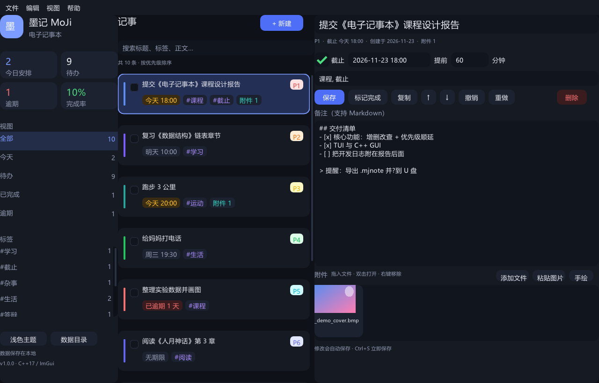
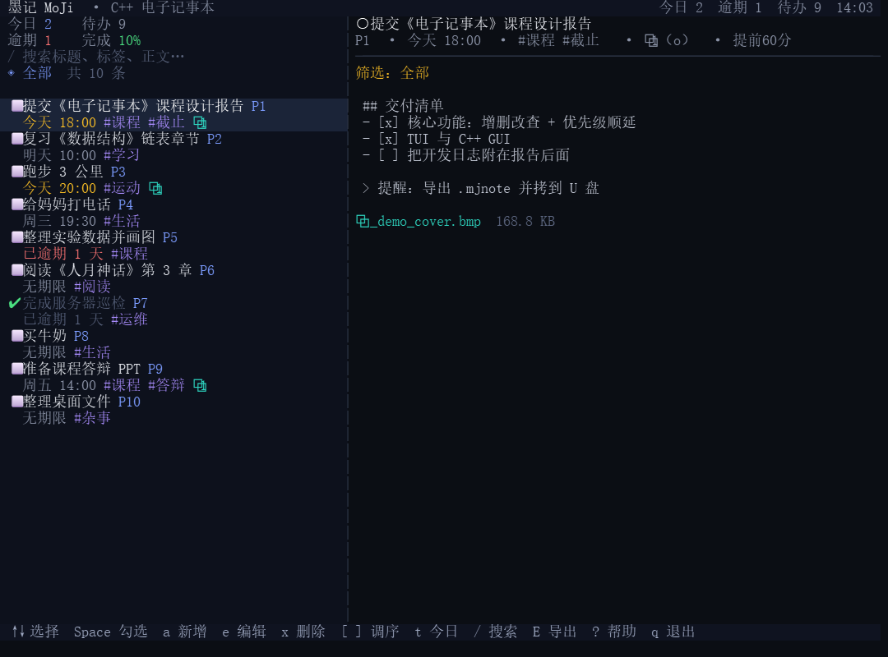

# 墨记 MoJi · 电子记事本（C++17）

> 课程设计《电子记事本的实现》主实现：**C++17 + 单向优先级链表 + UTF-8 文本存储 + 控制台 TUI + Dear ImGui / DirectX11 图形界面**。
>
> 仓库内另有：
> - `c_legacy/`：C89 单文件基础版（菜单循环 + 链表 + 文本文件 + 蜂鸣）。
> - `python_prototype/`：开发早期的 Python 原型（含 40 项测试），不参与本次 C++ 提交，保留作对照。


| 深色 GUI | 控制台 TUI |
| --- | --- |
|  |  |

---

## 目录

- [功能](#功能)
- [构建与运行](#构建与运行)
- [使用](#使用)
- [数据与存储](#数据与存储)
- [设计](#设计)
- [测试](#测试)
- [C89 基础版](#c89-基础版)
- [Python 原型](#python-原型)
- [已知限制](#已知限制)
- [第三方库](#第三方库)

---

## 功能

### 基础要求

| 要求 | C++ 实现 |
| --- | --- |
| 输入待办、当天安排提醒（蜂鸣） | TUI/GUI 启动提醒、到点/提前提醒；`MessageBeep` + 弹窗；`src/core/model.cpp::needs_reminder` |
| 修改处理时间、编辑优先级 | 编辑器改截止时间；`↑/↓`、`[`/`]`、位置输入调整 |
| 插入后优先级顺延 | `EventList::insert_at`：原第 N 位及之后所有事件 +1 |
| 删除、修改记录 | 删除确认 + 撤销；标题/备注/截止/标签/优先级全字段编辑 |
| 按时间查询当日事宜 | `Repository::due_on`、今日视图、`moji list --today/--date` |
| 显示全部或部分 | 全部/今天/待办/已完成/逾期 + 标签 + 关键字搜索 |
| 菜单、循环、界面友好 | TUI 快捷键 + 鼠标；GUI 侧边栏 + 卡片流；C 版菜单循环 |
| 文本文件存储 | `%USERPROFILE%\.moji\events.json`（UTF-8 文本）+ 附件目录 |

### 拓展功能

- **控制台 TUI**：侧边栏实时显示任务、统计、标签；`Space` 勾选；鼠标点左侧方框勾选；双击编辑；模态输入表单；`Ctrl+Z/Y`；到点响铃 + 提醒条。
- **ImGui GUI**：Material 风格浅色/深色主题、卡片列表、内联编辑、自动保存、统计卡、标签筛选、搜索。
- **附件**：拖文件进窗口即添加；图片显示缩略图；双击用系统程序打开；右键移除；支持任意文件/音频。
- **粘贴图片**：按钮读取 Windows 剪贴板图片，保存为 PNG 附件。
- **手绘笔迹**：GUI 内置画板（颜色、粗细、撤销、清空），保存为 PNG 附件。
- **表格**：菜单一键插入 Markdown 表格模板。
- **导入导出**：`.mjnote`（ZIP + 附件）、`.json`、todo.txt、Markdown。
- **提醒**：30 秒轮询，提前 N 分钟；`MessageBeep` + 弹窗。
- **容错**：原子写入、自动备份、损坏恢复、路径穿越防护、撤销/重做、删除确认。
- **安装**：`install.ps1` 编译 → 安装到 `%LOCALAPPDATA%\MoJi\bin` → 自动写用户 PATH + 开始菜单快捷方式；终端 `moji` 默认进 TUI。

---

## 构建与运行

### 前置条件

- Windows 11（GUI 使用 DirectX11；Windows 10 同样可用）
- **MSYS2 UCRT64** 的 `g++`（本机测试版本 15.2.0），确保 `C:\msys64\ucrt64\bin` 在 PATH 中
- 无需安装 Qt / .NET；ImGui 与 nlohmann/json 已随仓库提供

### 一键构建

在项目根目录打开 cmd / PowerShell：

```bat
.\build.bat
```

> 如果当前目录策略禁止直接执行当前目录程序，用 `.\build.bat` 或 `call build.bat`。

或 MSYS2 / Git Bash：

```bash
bash build.sh
```

产物：

```
build\moji.exe       控制台版：CLI / TUI / GUI（moji gui）
build\moji-gui.exe   窗口版：双击直接打开 GUI，无控制台
build\test_core.exe  C++ 核心测试（62 个检查）
```

### 安装到系统

```powershell
powershell -ExecutionPolicy Bypass -File .\install.ps1
```

脚本会：

1. 调用 `build.bat` 编译；
2. 复制两个 exe 到 `%LOCALAPPDATA%\MoJi\bin`；
3. 把该目录写入**用户 PATH**；
4. 创建开始菜单快捷方式「墨记 MoJi」。

之后新开终端即可：

```bat
moji                  :: 默认进入 TUI
moji gui              :: 打开 GUI
moji-gui              :: 双击版 GUI
```

`package.ps1` 可生成便携 zip：`dist\moji-cpp-1.0.0.zip`。

### 直接运行构建产物

```bat
build\moji.exe                       :: TUI（无参数）
build\moji.exe gui                   :: GUI
build\moji.exe -d D:\notes gui       :: 指定数据目录
build\moji-gui.exe                   :: 窗口版 GUI（读取 MOJI_HOME）
```

---

## 使用

### TUI

| 按键 | 作用 |
| --- | --- |
| `↑` `↓` | 选择任务；`PgUp/PgDn` 翻页 |
| `Space` / `d` | 勾选 / 取消；也可鼠标点左侧方框 |
| `a` | 新增（标题、截止、标签、提醒、位置、备注） |
| `e` | 编辑选中任务 |
| `x` / `Delete` | 删除（需确认） |
| `[` / `]` | 提高 / 降低优先级 |
| `t` / `0` / `1` / `2` / `3` | 今日 / 全部 / 待办 / 已完成 / 逾期 |
| `/` | 搜索（Esc 清空） |
| `o` | 查看附件（输入编号打开） |
| `Ctrl+Z` / `Ctrl+Y` | 撤销 / 重做 |
| `E` / `I` | 导出 / 导入 |
| `?` | 帮助 |
| `q` | 退出 |

TUI 使用 ANSI 真彩色，在 Windows Terminal / conhost 中均可运行；建议窗口 ≥ 100×30。

### GUI

- 左侧：统计卡、视图、标签、主题、数据目录。
- 中间：搜索、卡片流；点击选中，双击聚焦备注，点勾选框完成。
- 右侧：标题、截止、提醒、标签、备注、附件；修改后约 0.7 秒自动保存。
- 附件：从资源管理器拖入窗口、粘贴剪贴板图片、手绘、双击打开、右键移除。
- 菜单/快捷键：`Ctrl+N` 新建、`Ctrl+S` 保存、`Ctrl+F` 搜索、`Ctrl+Alt+Z/Y` 撤销/重做、`F1` 帮助、`F5` 刷新。

### 命令行

```bat
moji add "买牛奶" -u "2026-11-24 18:00" -t 生活
moji add "插队任务" -p 2             :: 插到第 2 位，原 P2 及之后顺延
moji list
moji list --today
moji list --date 2026-11-24
moji list --overdue --limit 10
moji search 报告
moji show 3
moji done 3
moji undo                            :: 跨进程撤销（写操作前自动快照）
moji undo --redo
moji export D:\backup.mjnote        :: 含附件
moji import D:\backup.mjnote
moji stats
moji seed-demo                       :: 演示数据（含 BMP/WAV/TXT 附件）
moji doctor
```

---

## 数据与存储

默认目录：`%USERPROFILE%\.moji`（可用 `--data-dir` 或 `MOJI_HOME` 修改）。

```
~/.moji/
├── events.json              # 主数据（UTF-8 JSON 文本）
├── events.json.bak          # 最近一次成功保存
├── backups/                 # 自动备份 + 命令行撤销快照
│   ├── events-YYYYMMDD-HHMMSS-微秒.json
│   ├── undo-...
│   └── redo-...
├── config.json              # 主题等
└── attachments/<event-id>/  # 附件按事件隔离
```

`events.json` 片段：

```json
{
  "app": "moji-note",
  "version": 1,
  "count": 1,
  "events": [
    {
      "id": "59535cd3",
      "title": "提交课程设计报告",
      "note": "## 清单\n- [x] 核心功能",
      "due": "2026-11-23T18:00:00",
      "priority": 1,
      "done": false,
      "tags": ["课程", "截止"],
      "attachments": [
        {"path": "attachments/59535cd3/cover.bmp", "name": "cover.bmp",
         "mime": "image/bmp", "size": 172854}
      ],
      "remind_before": 60
    }
  ]
}
```

- **原子写入**：临时文件 → `MoveFileExW(MOVEFILE_REPLACE_EXISTING|WRITE_THROUGH)`。
- **损坏恢复**：主文件解析失败时尝试 `.bak`，并把损坏文件隔离为 `events.json.corrupt-*`。
- **跨设备迁移**：`.mjnote` 为 **store 方式 ZIP**（`manifest.json` + `files/`），导入时附件重新落盘并重映射路径。

---

## 设计

### 分层

```
┌────────────────────────────────────────────┐
│  CLI (main.cpp) / TUI (tui.cpp) / GUI (gui.cpp) │
├────────────────────────────────────────────┤
│  Repository  — 增删改查、查询、撤销、附件        │
├────────────────────────────────────────────┤
│  EventList（优先级单向链表） · importer · zip    │
├────────────────────────────────────────────┤
│  Store  — 文本文件、备份、快照、附件、容错        │
└────────────────────────────────────────────┘
```

TUI 与 GUI 共用同一套 `Repository` 和文件，行为一致。

### 优先级链表

```
[P1 买牛奶] -> [P2 写报告] -> [P3 跑步]
        ↑ 在第 2 位插入“取快递”
[P1 买牛奶] -> [P2 取快递] -> [P3 写报告] -> [P4 跑步]
```

`EventList` 是手写单向链表；插入/删除后统一 `reindex()`，任何时刻 `priority == 位置序号`。

### 主要函数原型（节选）

```cpp
// core/model.hpp
Event Event::create(title, note, due, tags, remind_before, color);
json Event::to_json() const;
Event Event::from_json(const json&);
bool Event::needs_reminder(std::time_t at) const;

// core/elist.hpp
Event& EventList::append(Event event);
Event& EventList::insert_at(int pos, Event event);   // 顺延核心
std::optional<Event> EventList::remove(const std::string& id);
bool EventList::move_to(const std::string& id, int pos);
void EventList::reindex();

// core/store.hpp
std::vector<json> Store::load_events();
void Store::save_events(const std::vector<json>&);
Attachment Store::add_attachment(event_id, const fs::path& src);
fs::path Store::resolve(const std::string& rel) const; // 防路径穿越
void Store::snapshot(tag, keep);
bool Store::restore_last(tag);

// core/repository.hpp
Event& Repository::add(title, note, due, tags, position, remind, color);
Event& Repository::update(id, title, note, due, tags, remind, color);
Event& Repository::set_done(id, bool);
bool Repository::remove(id);
bool Repository::move_to(id, pos) / move_by(id, delta);
std::vector<Event*> Repository::due_on(day);
std::vector<Event*> Repository::search(keyword);
bool Repository::undo() / redo();
ImportReport Repository::import_events(std::vector<Event>, bool merge,
                                       const std::function<void(Event&)>& fill);

// core/importer.hpp
void export_json(Repository&, path);
ImportReport import_json(Repository&, path, bool merge);
fs::path export_bundle(Repository&, path);
ImportReport import_bundle(Repository&, path, bool merge);
void export_todotxt / import_todotxt / export_markdown;

// GUI
int run_gui(Repository& repo, const std::string& screenshot_path = "");
```

完整说明见 [`docs/设计说明.md`](docs/设计说明.md)。

### 容错

| 场景 | 处理 |
| --- | --- |
| 写入中断 | 临时文件 + 原子替换 |
| 主文件损坏 | `.bak` 恢复 + 损坏文件隔离 |
| 单条坏记录 | 跳过并告警 |
| 附件丢失 | 界面标记，不删索引 |
| 路径穿越 | `weakly_canonical` 后校验必须位于数据目录 |
| 误删 | 确认框 + `Ctrl+Z`；附件延迟清理 |
| 命令行跨进程撤销 | 写操作前 `backups/undo-*.json` 快照 |
| 非法输入 | 时间格式、空标题、位置范围校验 |

---

## 测试

```bat
build\test_core.exe
```

输出：`checks=62 failures=0`。覆盖链表顺延、仓储 CRUD、撤销/重做、持久化、损坏恢复、路径穿越、ZIP、JSON/todo.txt/Markdown/打包往返、提醒窗口、CLI 快照。

图像模块测试（GDI+）：

```bat
g++ -std=c++17 -O2 -Isrc -Ithird_party tests\test_imaging.cpp src\gui\imaging.cpp src\core\util.cpp ^
    -o build\test_imaging.exe -static -lgdiplus -lgdi32 -lole32 -luuid
build\test_imaging.exe
```

UI 验证：TUI 已在 ConPTY 中实测新增/编辑/勾选/调序/撤销/退出；GUI 通过 `--screenshot` 离屏渲染浅色/深色截图，窗口版 `moji-gui.exe` 同样验证。

Python 原型保留 40 项测试，见 `python_prototype/`。

---

## C89 基础版

`c_legacy/notebook.c` 是课程基础要求的单文件 C 实现：

- 单向链表 + 优先级顺延
- `notes.dat` 管道分隔文本
- 菜单循环：显示、按日期查询、搜索、新增/插入、修改、完成、调序、删除、统计、保存
- 当天有安排时 `Beep` 蜂鸣
- 输入长度/格式校验、坏行跳过、临时文件 + `rename`

```bash
gcc -std=c89 -Wall -Wextra -O2 -o c_legacy/notebook c_legacy/notebook.c
./c_legacy/notebook [数据文件]
```

详见 [`c_legacy/README.md`](c_legacy/README.md)。

---

## Python 原型

`python_prototype/` 是开发早期用 Textual + PySide6 写的完整原型（40 项测试），用于快速验证交互和数据结构；**本次提交以 C++ 实现为准**。原型保留 pip 安装、托盘、附件拖动排序等 C++ 版本尚未完全覆盖的交互，可作为后续迭代参考。

```bash
cd python_prototype
python -m venv .venv && .venv\Scripts\activate
pip install -e ".[all]"
moji
```

---

## 已知限制

- GUI 使用 **Win32 + DirectX11 + ImGui**，目前仅 Windows；Linux 下构建脚本会生成核心 + 菜单式 TUI/CLI。
- C++ 版没有 pip 包（C++ 无法直接 pip 安装）；提供 `install.ps1` 便携安装与 `package.ps1` 打包。
- 附件支持拖入、缩略图、打开、移除；尚未实现附件坞内拖动排序（Python 原型已实现，可参考移植）。
- 音频附件调用系统默认播放器，未内置播放控件。
- 备注按 Markdown 纯文本保存，GUI 不做实时 Markdown 渲染。
- 主题、窗口大小持久化；数据默认不加密。

---

## 第三方库

- [Dear ImGui](https://github.com/ocornut/imgui) v1.91.0（MIT），`third_party/imgui/`
- [nlohmann/json](https://github.com/nlohmann/json) v3.11.3（MIT），单头文件 `third_party/nlohmann/json.hpp`
- 许可证原文见 `third_party/LICENSE-imgui.txt`、`third_party/LICENSE-nlohmann.txt`

## 相关文档

- [`开发日志.md`](开发日志.md) —— 从 Python 原型到 C++ 主实现的完整过程、踩坑与修复
- [`需求对照.md`](需求对照.md) —— 作业要求逐条对应
- [`docs/设计说明.md`](docs/设计说明.md) —— 数据结构、文件格式、函数原型、容错

## License

MIT
