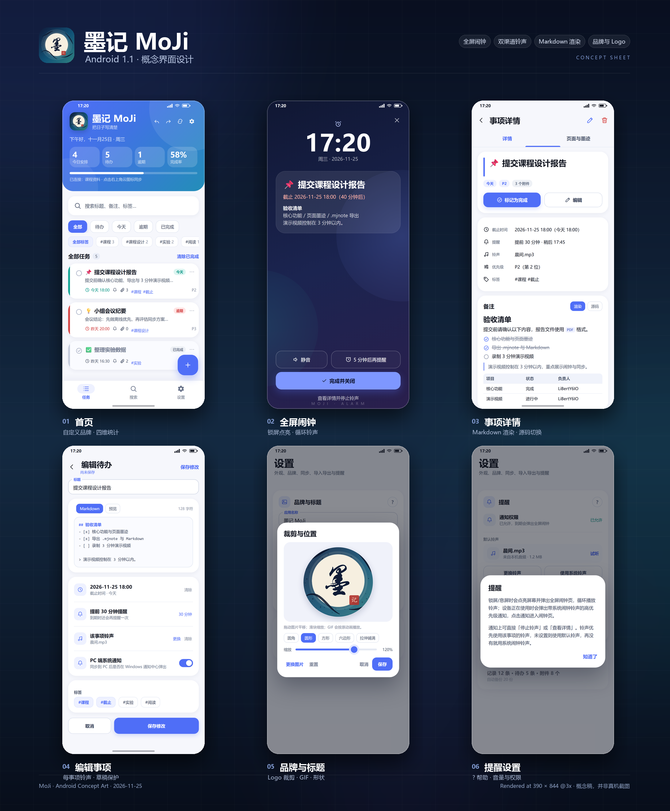

# 墨记 MoJi · Android

墨记（MoJi）电子记事本的 Android 客户端（当前版本 **1.2.0**）。
基于 Kotlin + Jetpack Compose + Material 3 实现，
与 PC 端 [仓库根目录](../) **共用同一套数据文件**：

- `events.json`（version 1，字段与 PC 端 `model.cpp` 一一对应）
- `.mjnote` 打包文件（store ZIP + `manifest.json`，manifest version 2）
- `todo.txt` / Markdown 导入导出
- `attachments/<event-id>/` 附件目录
- `page_layout`（OneNote 风格页面 + 墨迹 JSON）

因此可以把 PC 数据目录（默认 `%USERPROFILE%\.moji`）作为同步目录，在 Android 上直接拉取、
修改并写回；数据不依赖专有数据库，随时可用文本编辑器检查。

界面参考 [Kazumi](https://github.com/Predidit/Kazumi) 的 Material Design 风格：
大圆角卡片、渐变头图、柔和层级色、底部导航、悬浮按钮，并支持 Android 12+ 动态取色。

---

## 概念图



按 1.2.0 界面结构制作的 HTML/CSS 概念稿（390 × 844 @3x 渲染），**不是真机截图**。
[总览](docs/concept-art/00-overview.png) ·
[首页](docs/concept-art/01-home.png) ·
[全屏闹钟](docs/concept-art/02-alarm.png) ·
[事项详情](docs/concept-art/03-detail.png) ·
[编辑事项](docs/concept-art/04-editor.png) ·
[品牌与标题](docs/concept-art/05-brand.png) ·
[提醒设置](docs/concept-art/06-reminder.png)

设计与重新渲染说明见 [`docs/concept-art/README.md`](docs/concept-art/README.md)。

---

## 1. 功能

### 任务

- 优先级链表顺序（`priority` 连续编号，支持置顶 / 上移 / 下移 / 指定位置插入）
- 新建、编辑、删除、创建副本、完成 / 取消完成、批量清理已完成
- 截止时间（日期 + 时间选择器、快捷时间）、提前提醒、系统通知开关
- 标签（逗号 / 空格分隔，自动建议已有标签）、色条、emoji 图标
- 全文搜索（标题 / 备注 / 标签），筛选全部 / 待办 / 今天 / 逾期 / 已完成，按标签过滤
- 撤销 / 重做（内存快照，最多 60 步）
- 每次写操作自动保存 `events.json`、`events.json.bak` 与轮转备份（默认保留 20 份）
- 损坏主文件时自动从 `.bak` 恢复，并给出提示

### 备注与页面

- Markdown 编辑 / 预览：标题、列表、任务清单、引用、代码块、表格、分隔线、粗体 / 斜体 /
  删除线 / 行内代码 / 链接
- 「页面与墨迹」：820 × 1200 页面，文本层 + 图片层 + 墨迹层；画笔、橡皮、颜色、粗细、
  撤销、清空、添加图片；图片可拖动；修改后 700ms 防抖自动写入 `page_layout`
- 页面图片与墨迹完全沿用 PC 端 JSON 结构，可在两端交替编辑

### 附件

- 通过系统文件选择器添加任意文件，保存在 `attachments/<id>/`
- 图片缩略图与全屏预览；非图片用系统应用打开；FileProvider 安全共享
- 导出 `.mjnote` 时内嵌附件；导入时还原到本地附件目录

### 提醒

- **全屏闹钟页**：到点自动点亮屏幕（锁屏也显示），循环播放铃声并震动，提供
  「静音 / 5 分钟后再提醒 / 完成并关闭 / 查看详情」
- 默认铃声 + **每个事项单独铃声**（从本机选择音频，复制到应用私有目录），铃声音量 0–100
- 双通知渠道：锁屏/息屏走静音渠道 + 全屏闹钟；设备解锁时自动改用「有声」渠道，
  避免系统把全屏意图降级成横幅后完全没有声音；渠道被关闭时还会回退
- 通知自带「停止铃声」「查看详情」操作，点击通知正文直接打开闹钟页；回到应用也会自动停铃
- `AlarmManager` 精确闹钟（无权限时自动降级为普通闹钟）；设置页会检测
  「精确闹钟」「全屏通知」权限并提供一键跳转
- WorkManager 每 15 分钟后台扫描兜底
- 开机 / 时间变更 / 应用更新后自动重排闹钟
- 通知点击直接打开对应事项；全屏通知直接打开闹钟页
- 「稍后提醒」写入 `snooze_until`，与 PC 端字段一致

### 云同步（可选）

- 邮箱 + 密码注册 / 登录；**不登录也能完整使用本地功能，启动时不会强制登录**
- 登录后上传/下载 `.mjnote` 快照（含事项、Markdown、页面墨迹、附件）
- 每条记录按 `updated_at` 较新者合并；删除通过服务端墓碑同步，不会在另一台设备“复活”
- 云端变化较大时启动会弹窗询问，小变化自动同步
- 默认服务：`http://dsbot.taild07bbe.ts.net:8789`（可在登录页修改；
  没有 MagicDNS 时用 `http://100.116.113.16:8789`）
- 服务只在 Tailscale 内网开放；手机需与服务器在同一 tailnet，PC 需安装并登录 Tailscale
- 登录令牌只保存在本机 SharedPreferences；退出登录不会删除本地数据

### 同步与导入导出

- 选择任意 SAF 目录作为同步目录（持久授权），显示目录名
- **拉取**：读取远端 `events.json`，按 `updated_at` 合并，并补齐缺失附件
- **推送**：写回 `events.json`（旧文件转为 `events.json.bak`），复制附件
- **双向同步**：先合并拉取，再推送
- 导入 `.json` / `.mjnote` / `.txt`，可切换合并去重或覆盖
- 导出 `.json` / `.mjnote` / `.txt` / `.md`

### 外观与品牌

- 跟随系统 / 浅色 / 深色三种主题
- 8 种主题色；Android 12+ 动态取色
- **左上角品牌可自定义**：应用名称、副标题（均可留空）；Logo 支持 PNG / JPG / GIF，
  可缩放、拖动平移、拉伸铺满，并裁剪为圆角矩形、圆形、方形、六边形；GIF 保留动画
- 深色模式下「页面与墨迹」整页反相（纸变深、墨迹取补色），避免夜间刺眼
- 详情页备注默认渲染 Markdown，可一键切换「源码」查看/复制
- 设置项的长篇说明收进标题右侧的 `?` 帮助弹窗
- 边到边布局，适配状态栏与手势导航

### 统计口径

- 「今日安排 / 待办 / 逾期 / 完成率」与 PC 端 `Repository::stats` 对齐：
  今日包含已完成、完成率四舍五入、逾期只统计未完成
- 每 30 秒自动刷新统计与「今天 / 逾期」筛选，不依赖手动操作

---

## 2. 工程结构

```
app/src/main/java/com/moji/note/
├── MojiApp.kt                  Application、仓库单例、通知渠道
├── MainActivity.kt             Compose 入口、页面导航、权限
├── data/
│   ├── Model.kt                MojiEvent / Attachment / 时间与相对时间
│   ├── JsonCodec.kt            events.json 读写（org.json）
│   ├── TodoTxt.kt              todo.txt 导入导出
│   ├── MarkdownExport.kt       Markdown 导出
│   ├── MjnoteCodec.kt          .mjnote store ZIP 编解码
│   ├── Merge.kt                导入去重 / 双向同步合并
│   ├── Repository.kt           本地数据、附件、备份、撤销、导入导出
│   └── SyncManager.kt          SAF 目录拉取 / 推送
├── reminder/
│   ├── Notifications.kt        通知渠道与全屏提醒通知
│   ├── AlarmActivity.kt        全屏闹钟页（铃声 / 静音 / 稍后 / 完成）
│   ├── AlarmPlayer.kt          MediaPlayer 循环铃声 + 震动
│   ├── ReminderScheduler.kt    精确闹钟 + 周期扫描
│   ├── ReminderReceiver.kt     闹钟触发
│   ├── ReminderWorker.kt       15 分钟兜底扫描
│   └── BootReceiver.kt         开机重排
└── ui/
    ├── MojiViewModel.kt        状态、筛选、同步、设置
    ├── theme/Theme.kt          Material 3 配色 / 字体 / 圆角
    ├── components/             TaskCard、Markdown、BrandLogo、附件缩略图
    └── screens/                Home / Search / Editor / Detail / Settings / PageBoard
```

数据目录（应用私有）：

```
filesDir/moji/
├── events.json
├── events.json.bak
├── backups/events-YYYYMMDD-HHmmss.json
├── config.json
├── brand/logo.<ext>
├── ringtones/<file>
└── attachments/<event-id>/<file>
```

---

## 3. 快速开始

环境要求：JDK 17+、Android SDK Platform 35、Build-Tools 35.0.0、Gradle 8.9。

```bash
# 1. 配置 SDK（本机已配置 D:/Android/sdk）
echo "sdk.dir=D:/Android/sdk" > local.properties

# 2. 构建调试包
./gradlew :app:assembleDebug

# 3. 安装
adb install -r app/build/outputs/apk/debug/app-debug.apk
```

产物：`app/build/outputs/apk/debug/app-debug.apk`（约 17 MB）。

完整环境搭建、镜像、常见问题见 [`docs/构建说明.md`](docs/构建说明.md)；
与 PC 端的格式对照、同步规则、测试记录见 [`docs/Android移植说明.md`](docs/Android移植说明.md)。

---

## 4. 与 PC 端同步

1. PC 端关闭程序（或至少停止编辑），找到数据目录：默认 `%USERPROFILE%\.moji`。
2. 将该目录放到手机可访问的位置（数据线、局域网共享、网盘同步目录等），
   在 Android「设置 → 与 PC 端同步」中选择该目录。
3. 首次建议「拉取」；之后两边修改后点「双向同步」。
4. 合并规则：
   - 相同 `id`：`updated_at` 较新的一方胜出
   - 不同 `id` 但 `title + created_at` 相同：视为同一条，自动去重
   - 仅一方存在的记录：保留
   - 附件按 `attachments/<id>/<file>` 按需复制
5. 推送时会保留远端旧文件为 `events.json.bak`。

> 注意：同步期间请避免 PC 端同时写 `events.json`，否则以最后一次写入为准。

---

## 5. 测试

```bash
# 纯 JVM 单元测试（格式编解码 / 合并 / todo.txt / ZIP）
./gradlew :app:testDebugUnitTest
```

当前 10 项测试覆盖（云同步联调需设置 `MOJI_CLOUD_TEST=1`）：

- `events.json` 字段往返（含 `ringtone` / `snooze_until`）、PC 旧格式标签字符串兼容、空时间写法
- 稍后提醒：`snooze_until` 推后下一次提醒且不重复，早于基础提醒的时刻不会提前触发
- 时间解析（`T` / 空格 / `/` / 结尾 Z / 非法输入）
- todo.txt 往返（优先级、完成状态、标签空格转义、due）
- 导入去重、id 冲突重分配、重编号
- 双向同步 `updated_at` 胜负与远端独有记录
- `.mjnote` STORED 条目、manifest、附件字节往返
- 优先级链表不变量
- 云同步服务端注册/上传/下载联调（Android `CloudApiIntegrationTest`）

另在临时 ASCII 目录用真实 PC 数据（`%USERPROFILE%\.moji\events.json` 及其附件）
做过解析 → 重写 → `.mjnote` 打包解包的兼容性回归，通过。

> Windows 中文路径下 Gradle 测试 worker 存在已知的 classpath 编码问题
> （`ClassNotFoundException`，APK 构建不受影响）；遇到时把工程复制到纯 ASCII 路径
> 再跑测试即可，详见构建说明的「常见问题」。

---

## 6. 已知差异

- 页面图片支持添加 / 拖动 / 层叠，未实现 PC 端的缩放与旋转手柄（已有 `w/h/rot` 会原样保留）。
- Markdown 反向导入不支持（与 PC 一致）；Markdown 预览不解析 PC 备注里的 `{color:...}` 自定义着色标记。
- Android 没有 PC 的「托盘提醒」概念，提醒统一走系统通知 + 全屏闹钟页；`system_notify`
  字段仍会保存并在详情中展示，但 Android 端所有到期事项都会提醒（与 PC 的应用内提醒一致）。
- PC 端记录里的 `ringtone` 若是 Windows 绝对路径，Android 无法直接使用，会回退到默认铃声/系统闹钟；
  在 Android 上重新选择铃声即可保存为可移植的相对路径。
- 反过来，Android 选择的铃声保存在应用私有目录 `ringtones/`，不会随 `events.json` 同步到 PC，
  PC 端会回退到默认铃声。需要两端各自选择一次。
- 设备解锁且正在使用时，Android 一般不会启动全屏页，此时先用通知渠道的系统闹钟铃声提示；
  点击通知进入闹钟页后才使用默认/事项自定义铃声并循环播放。
- 多选批量操作未实现；可通过逐条菜单或「清除已完成」完成批量清理。
- 精确闹钟受系统省电策略影响时会降级，15 分钟后台扫描作为兜底。
- 主题/动态取色是 Android 端设置；PC 端 `config.json` 的配置不会覆盖 Android UI 设置。

---

## 7. 许可证与致谢

课程设计项目，供学习与自用。UI 参考 Kazumi（Material Design 3 风格），
数据格式与 PC 端墨记实现保持兼容。
