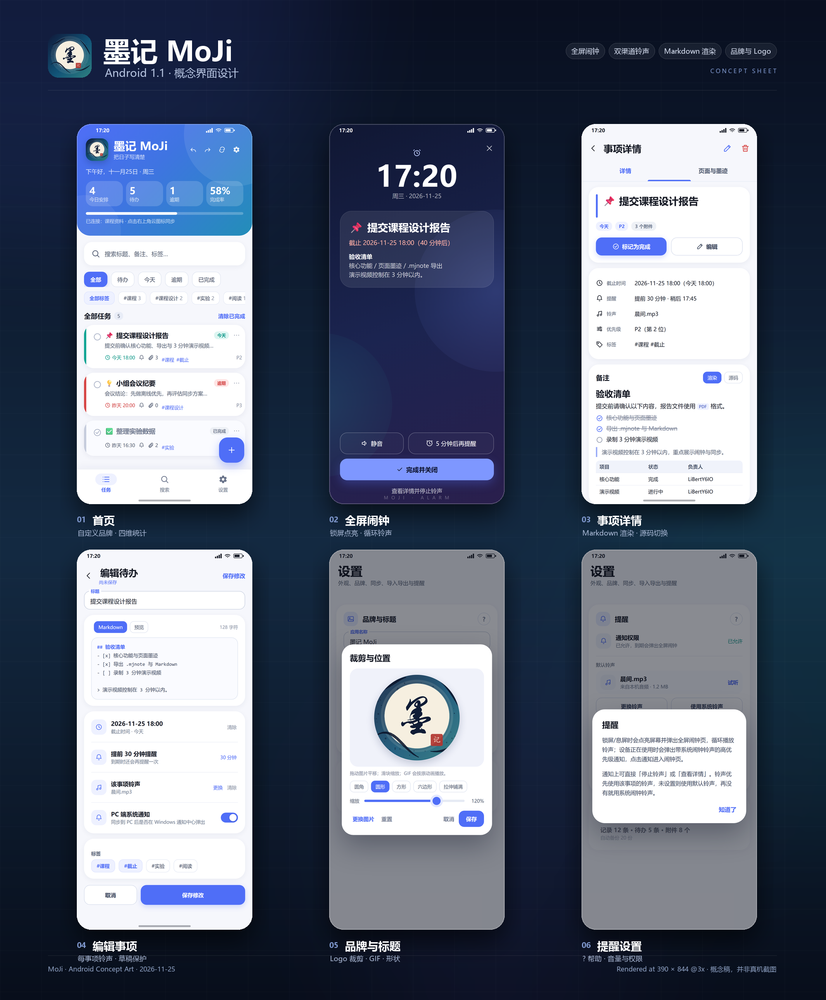

# 墨记 MoJi · Android 概念图

这些图是按 Android 客户端 1.2.0 的 Compose 界面结构制作的 **概念稿 / 设计稿**，
用 HTML + CSS 以 390 × 844 逻辑尺寸设计，Chrome 以 3 倍缩放渲染为 1170 × 2532 PNG。
**它们不是真机截图**，字体、状态栏、系统圆角等会因手机 ROM 不同而略有差异；
图中的任务、统计数字、文件名均为示例数据。



## 六屏一览

| 图 | 屏幕 | 重点展示 |
| --- | --- | --- |
| [01-home.png](01-home.png) | 首页 | 自定义品牌名/副标题/Logo、四维统计、30 秒刷新、搜索与筛选 |
| [02-alarm.png](02-alarm.png) | 全屏闹钟 | 锁屏点亮、循环铃声、静音 / 5 分钟后再提醒 / 完成 |
| [03-detail.png](03-detail.png) | 事项详情 | Markdown 默认渲染、渲染 / 源码切换、提醒与铃声元信息 |
| [04-editor.png](04-editor.png) | 编辑事项 | Markdown 编辑、每事项铃声、截止/提前提醒、PC 通知开关 |
| [05-brand.png](05-brand.png) | 品牌与标题 | Logo 选择、圆形裁剪、缩放/平移、GIF、形状切换 |
| [06-reminder.png](06-reminder.png) | 提醒设置 | 通知/精确闹钟/全屏权限、默认铃声、音量、`?` 帮助弹窗 |

## 设计要点

- **主色**：`#4f6ef7`，渐变从主色过渡到青蓝 `#238eb8`
- **背景**：`#f6f7fc`；卡片纯白、22 dp 大圆角、极轻阴影
- **闹钟**：`#101733 → #1b2450 → #2a1f4d` 深色渐变，白色大号时钟
- **品牌 Logo**：墨迹印章式图形，演示圆形裁剪、缩放 120% 与平移后的效果
- **数据**：示例为 4 条今日安排、5 条待办、1 条逾期、58% 完成率

## 重新渲染

需要 Python 3、Windows 字体（微软雅黑 / 华文行楷）、Chrome 或 Edge。

```bash
cd docs/concept-art/source
python build_pages.py

CHROME="C:/Program Files/Google/Chrome/Application/chrome.exe"
for f in home alarm detail editor brand reminder; do
  URL=$(python -c "import pathlib; print(pathlib.Path('$f.html').resolve().as_uri())")
  OUT=$(python -c "import pathlib; print(pathlib.Path('$f.png').resolve())")
  "$CHROME" --headless=new --disable-gpu --hide-scrollbars \
    --force-device-scale-factor=3 --window-size=390,844 \
    --allow-file-access-from-files --virtual-time-budget=3000 \
    --screenshot="$OUT" "$URL"
done
```

`build_pages.py` 会把 `assets/logo.png` 内嵌为 base64，避免 `file://` 下图片加载失败。
总览海报由 `build_overview.py` 合成（需 Pillow）：

```bash
python build_overview.py
```

修改 `style.css` 或 `build_pages.py` 后重新执行即可得到新的概念图。
