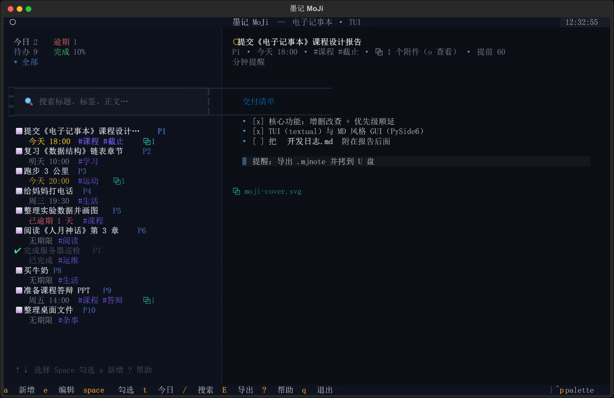
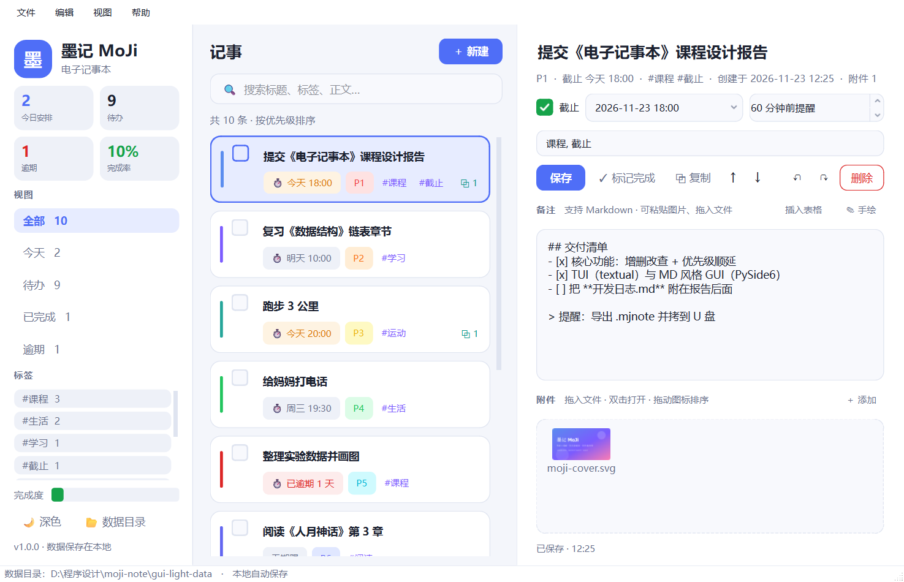
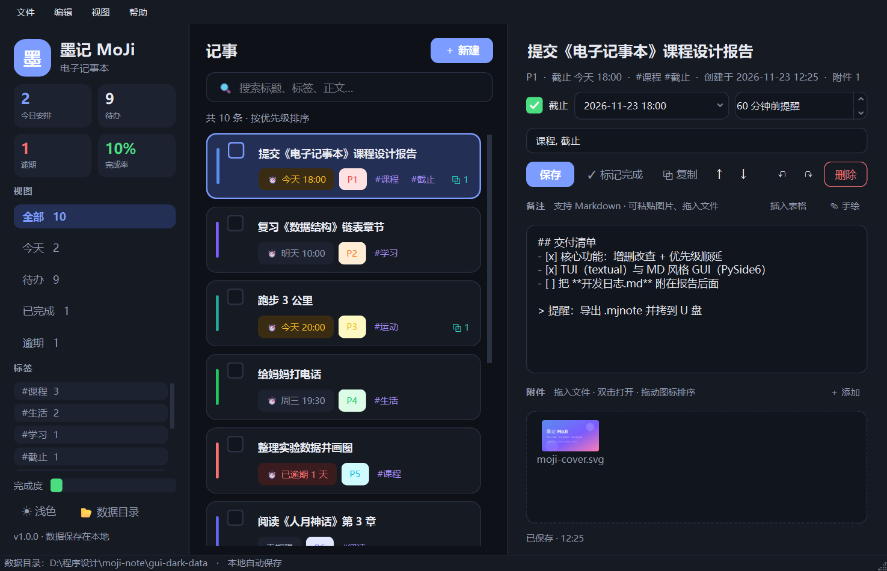

# 墨记 MoJi · Python 原型（非提交主实现）

> **注意：本次课程设计的主实现是仓库根目录的 C++17 版本（`../src`、`../README.md`）。**
> 这里是开发早期用 Python 快速验证交互与数据结构的原型，保留 pip 安装、附件排序等参考实现，便于对照。

> 课程设计《电子记事本的实现》—— 一套核心 + 两种界面 + 一份 C 语言基础实现。

墨记是一个**本地优先**的跨平台电子记事本：核心用纯标准库实现，提供 **TUI（终端）** 与 **Material Design 风格 GUI** 两套界面；另附一份 C89 单文件实现，直接对应课程“基础要求”。数据保存在一个 UTF-8 文本文件里，附件按事件分目录存放，支持打包迁移、todo.txt 互通、Markdown 导出。



| 浅色 GUI | 深色 GUI |
| --- | --- |
|  |  |

---

## 目录

- [功能一览](#功能一览)
- [快速开始](#快速开始)
- [使用说明](#使用说明)
- [数据与存储](#数据与存储)
- [设计说明](#设计说明)
- [测试](#测试)
- [C 语言版](#c-语言版)
- [部署到服务器](#部署到服务器)
- [目录结构](#目录结构)
- [已知限制](#已知限制)
- [开发日志](#开发日志)

---

## 功能一览

### 基本要求

| 要求 | 实现 |
| --- | --- |
| 记事、输入待办、当天安排提醒（蜂鸣） | TUI/GUI 启动问候 + 到点提醒；C 版启动时 `Beep`；`core/reminders.py` |
| 修改处理时间、编辑优先级 | 编辑截止时间；位置输入 / `[` `]` / ↑↓ 调整优先级 |
| 插入事件后优先级顺延 | `EventList.insert_at`：原第 N 位及之后整体 +1 |
| 删除、修改记录 | 删除（确认 + 撤销）、内联编辑、批量清理已完成 |
| 按时间查询当日事宜 | `due_on` / 今日视图 / `moji list --today` / C 版按日期查询 |
| 显示全部或部分 | 全部 / 今天 / 待办 / 已完成 / 逾期 + 标签 + 关键字搜索 |
| 菜单、循环、界面友好 | C 版菜单循环；TUI 底部快捷键；GUI 侧边栏与内联编辑器 |
| 文本文件存储 | `events.json`（UTF-8 文本）+ C 版 `notes.dat` 管道分隔文本 |

### 拓展功能

- **附件**：图片、音频、任意文件拖入即存；双击用系统默认程序打开。
- **粘贴图片**：在备注里 `Ctrl+V` 直接把剪贴板图片存为附件。
- **笔迹**：GUI 内置手绘板，画完保存为 PNG 附件。
- **表格**：一键插入 Markdown 表格模板。
- **媒体拖动**：附件坞支持内部拖动排序、拖入文件；不受文本编辑框限制。
- **双 UI**：Textual TUI + PySide6 GUI，共用同一套核心与数据。
- **TUI 侧边栏**：实时显示任务、优先级、截止、标签、附件数；`Space` 勾选，也可**鼠标点击左侧方框**勾选；双击编辑。
- **命令行**：`moji` 默认进 TUI；`moji add/list/done/search/undo/export/import` 等。
- **导入导出**：`.mjnote`（ZIP + 附件，跨设备）、`.json`、`.txt`（todo.txt 生态）、`.md`。
- **提醒**：到点/提前 N 分钟，TUI 响铃 + 通知，GUI Toast + 系统托盘通知。
- **主题**：浅色 / 深色 MD 风格，配置持久化。
- **容错**：原子写入、自动备份、损坏文件隔离与回收、路径穿越防护、撤销/重做、删除确认。

---

## 快速开始

### 方式一：一键安装脚本（自动加入用户 PATH）

Windows PowerShell：

```powershell
powershell -ExecutionPolicy Bypass -File .\install.ps1
```

Linux / macOS：

```bash
bash install.sh
```

脚本会：安装 `moji-note[all]` → 把 pip 用户级 Scripts 目录写入用户环境变量 → 提示重新打开终端后使用 `moji`。

### 方式二：虚拟环境安装

```bash
python -m venv .venv
# Windows
.venv\Scripts\activate
# Linux / macOS
source .venv/bin/activate

pip install -e ".[all]"
moji
```

只想要终端版可以不装 Qt：`pip install -e ".[tui]"`；只想要 GUI：`pip install -e ".[gui]"`；核心库与命令行不需要任何第三方依赖。

> 国内网络建议加镜像：`pip install -i https://pypi.tuna.tsinghua.edu.cn/simple -e ".[all]"`。
> 如果 pip 被系统代理卡住（本机系统代理 127.0.0.1:7890 会被 Python 误当成 HTTPS 代理）：
> - PowerShell：`$env:NO_PROXY='*'` 后再执行 pip；
> - Bash：`NO_PROXY="*" pip install ...`。
> 若 pip 构建隔离拉不到 `setuptools`，先 `pip install -U setuptools wheel`，再加 `--no-build-isolation`。
> `install.ps1` 已内置以上处理：自动设置 `NO_PROXY`、优先走清华镜像（失败再回退默认 PyPI）、用 `--no-build-isolation` 构建。

### 启动

```bash
moji            # 终端界面（默认，推荐先试这个）
moji gui        # Material Design 图形界面
moji --help     # 所有子命令
```

首次运行可以写入演示数据：

```bash
moji seed-demo        # 空数据目录时可用
moji seed-demo --force # 覆盖已有数据前会提示
```

数据目录默认 `~/.moji`，可用 `--data-dir` 或环境变量 `MOJI_HOME` 指定：

```bash
moji --data-dir D:\我的记事 gui
# 或
set MOJI_HOME=D:\我的记事
```

---

## 使用说明

### TUI 快捷键

| 按键 | 作用 |
| --- | --- |
| `↑` `↓` | 选择任务（侧边栏实时显示任务） |
| `Space` / `d` | 勾选 / 取消勾选；也可直接用鼠标点左侧方框 |
| `a` | 新增（模态表单：标题、截止、标签、提醒、优先级位置、备注） |
| `e` / 双击 | 编辑选中任务 |
| `x` / `Delete` | 删除（确认框） |
| `[` / `]` | 提高 / 降低优先级（链表重排） |
| `t` / `0` / `1` / `2` / `3` | 今日 / 全部 / 待办 / 已完成 / 逾期 |
| `/` | 聚焦搜索；`Esc` 清空搜索 |
| `o` | 附件列表（回车打开、删除键移除） |
| `Ctrl+Z` / `Ctrl+Y` | 撤销 / 重做 |
| `E` / `I` | 导出 / 导入 |
| `?` | 帮助 |
| `q` | 退出 |

### GUI 操作

- 左侧：统计卡、视图筛选、标签、主题与数据目录。
- 中间：卡片流；点击查看，双击定位到备注，勾选框直接完成。
- 右侧：标题、截止时间、提前提醒、标签、备注、附件，全部**自动保存**（约 0.65 秒防抖），也可 `Ctrl+S` 立即保存。
- 附件坞：拖入文件、拖动图标排序、双击打开、右键移除；备注框支持拖入文件和粘贴图片。
- 菜单：文件（新建/导入/导出）、编辑（应用级撤销/重做、完成、插入表格、手绘）、视图（主题/刷新）、帮助。

快捷键：`Ctrl+N` 新建、`Ctrl+S` 保存、`Ctrl+F` 搜索、`Ctrl+O` 导入、`Ctrl+Shift+S` 导出、`Ctrl+Alt+Z/Y` 应用级撤销/重做、`Ctrl+Return` 完成、`F1` 快捷键、`F5` 刷新。

### 命令行

```bash
moji add "买牛奶" -u "2026-11-24 18:00" -t 生活 -t 采购
moji add "插队任务" -p 2              # 插到第 2 位，原第 2 位及之后顺延
moji list                           # 全部
moji list --today
moji list --date 2026-11-24          # 查询指定日期
moji list --overdue
moji search 报告
moji show 3                         # 按优先级序号或 id 前缀
moji done 3
moji undo                           # 跨命令行进程也能撤销
moji export ~/Desktop/backup.mjnote  # 含附件
moji import ~/Desktop/backup.mjnote
moji stats
moji doctor                         # 环境、数据目录、写权限自检
```

---

## 数据与存储

默认位置：

```
~/.moji/
├── events.json              # 主数据：UTF-8 JSON 文本
├── events.json.bak          # 最近一次成功保存的副本
├── config.json              # 主题、窗口大小、备份数量
├── backups/                 # 自动备份 + 命令行撤销快照
│   ├── events-20261123-123000.json
│   ├── undo-20261123-123500-123456.json
│   └── redo-...
└── attachments/
    └── <event-id>/          # 每个事件独立的附件目录
        ├── moji-cover.svg
        └── ding.wav
```

`events.json` 示例：

```json
{
  "app": "moji-note",
  "version": 1,
  "updated_at": "2026-11-23T12:30:00",
  "count": 1,
  "events": [
    {
      "id": "59535cd3",
      "title": "提交课程设计报告",
      "note": "### 交付清单\n- [x] 核心功能\n- [ ] 开发日志",
      "due": "2026-11-23T18:00:00",
      "priority": 1,
      "done": false,
      "tags": ["课程", "截止"],
      "attachments": [
        {"path": "attachments/59535cd3/cover.svg", "name": "cover.svg", "mime": "image/svg+xml", "size": 1024}
      ],
      "created_at": "2026-11-23T12:00:00",
      "updated_at": "2026-11-23T12:00:00",
      "remind_before": 60,
      "color": "#5b8def"
    }
  ]
}
```

**为什么用文本 JSON 而不是二进制？** 可以直接 diff、grep、手工修复、云盘同步；附件二进制单独存放，不把 JSON 撑大。C 版则使用更朴素的 `id|priority|due|done|title|note` 行格式，便于 VC++6.0 环境演示。

**跨设备迁移**：使用 `.mjnote`（ZIP：`manifest.json` + `files/`），导入时自动把附件复制进新数据目录并重映射路径。`.json` 只含附件索引，适合纯文本备份；`.txt` 可与其他 todo.txt 工具互通。

---

## 设计说明

### 优先级链表

优先级不是随手填的数字，而是**链表中的位置**。`EventList` 是一个手写单向链表：

```
[P1 买牛奶] -> [P2 写报告] -> [P3 跑步]
```

在第 2 位插入“取快递”：

```
[P1 买牛奶] -> [P2 取快递] -> [P3 写报告] -> [P4 跑步]
```

原 P2“写报告”自动变成 P3，正是题目要求的顺延规则。删除、移动、排序后统一 `reindex()`，任何时刻 `priority == 位置序号`。

### 分层

```
┌─────────────────────────────┐
│  CLI / TUI / GUI            │  展示与交互
├─────────────────────────────┤
│  Repository                 │  增删改查、查询、撤销、附件
├─────────────────────────────┤
│  EventList  ·  importer     │  数据结构与格式转换
├─────────────────────────────┤
│  Store                      │  文本文件、附件、备份、容错
└─────────────────────────────┘
```

TUI 与 GUI 只依赖 `Repository`，因此数据、查询、撤销、导入导出行为完全一致。

### 函数原型（节选）

完整签名见源码与 [`docs/设计说明-python.md`](docs/设计说明-python.md)。

```python
# core/models.py
Event(title: str, *, id="", note="", due: datetime|None=None, priority=1,
      done=False, tags: list[str]=..., attachments: list[Attachment]=...,
      remind_before=0, color="") -> Event

# core/elist.py
EventList.insert_at(pos: int, event: Event) -> Event   # 顺延核心
EventList.move_to(event_id: str, pos: int) -> bool
EventList.remove(event_id: str) -> Event | None

# core/repository.py
Repository.add(title, note="", due=None, tags=None, position=None,
               remind_before=0, color="") -> Event
Repository.update(event_id, **changes) -> Event
Repository.set_done(event_id, done=True) -> Event
Repository.move_to(event_id, position) -> Event
Repository.due_on(day: date | str) -> list[Event]
Repository.search(keyword: str) -> list[Event]
Repository.undo() -> bool / redo() -> bool
Repository.add_attachment(event_id, src_path) -> Attachment
Repository.reorder_attachments(event_id, rel_paths) -> Event

# core/storage.py
Store.load_events() -> list[dict]
Store.save_events(events: list[dict]) -> None    # 原子写 + 自动备份
Store.snapshot(tag="undo") / restore_last(tag)   # CLI 跨进程撤销

# core/importer.py
export_bundle(repo, path) -> (Path, int)
import_bundle(repo, path, merge=True) -> dict
export_todotxt(repo, path) / import_todotxt(repo, path)
export_markdown(repo, path)
```

C 版原型：

```c
typedef struct Event { int id; int priority; int done; char title[128];
                       char note[512]; char due[20]; char created[20];
                       struct Event *next; } Event;

void  list_insert_at(Event **head, Event *ev, int pos);
void  list_unlink(Event **head, Event *target);
int   list_remove(Event **head, int id);
void  list_reindex(Event *head);
int   load_file(Event **head, const char *path);
int   save_file(Event *head, const char *path);
void  beep_reminder(Event *head);
```

### 容错设计

| 场景 | 处理 |
| --- | --- |
| 写入中途断电/磁盘满 | 写临时文件 → `fsync` → `os.replace` 原子替换；失败保留原文件 |
| 主数据损坏 | 自动从 `.bak` 恢复；损坏文件隔离为 `events.json.corrupt-时间`，不删除 |
| 单条记录字段损坏 | 跳过该条并给出提示，其余正常加载 |
| 附件文件丢失 | 列表里标出“文件丢失”，不崩溃、不静默删除索引 |
| 路径穿越 | 附件路径解析必须位于数据目录内，否则拒绝 |
| 用户误删 | 删除前确认；`Ctrl+Z` 撤销；附件文件延迟清理，撤销后可恢复 |
| 空标题/非法时间/非法位置 | 表单与 Repository 双层校验，错误以 Toast/通知展示 |
| 并发/多进程修改 | TUI 每 4 秒检测文件 mtime，自动重载并提示 |
| 命令行跨进程撤销 | 写操作前写入 `backups/undo-*.json`，`moji undo` 恢复并可 `--redo` |

---

## 测试

```bash
python -m unittest discover -s tests -v
```

覆盖：链表顺延、增删改查、排序、持久化、损坏恢复、附件、路径穿越、导入导出（JSON/todo.txt/Markdown/打包）、提醒窗口、CLI 全流程、TUI 交互（含鼠标勾选、双击编辑、模态表单）、GUI 交互（自动保存、筛选、附件、粘贴图片、主题）。GUI 测试自动使用 Qt offscreen 平台。

当前测试：**40 项全部通过**（详见开发日志）。

C 版手工回归：

```bash
gcc -std=c89 -Wall -Wextra -O2 -o ../c_legacy/notebook ../c_legacy/notebook.c
printf '4\n买牛奶\n2026-11-24 18:00\n超市\n5\n插队\n2026-11-24 12:00\n\n2\n1\n0\n' \
  | ../c_legacy/notebook /tmp/notes.dat
```

---

## C 语言版

`../c_legacy/notebook.c` 是单文件 C89 实现，对应课程**基础要求**（不含附件等拓展）：

- 单向链表 + 优先级顺延
- 文本文件 `notes.dat`
- 菜单 + 循环：显示、按日期查询、关键字搜索、新增/插入、修改、完成、调序、删除、统计、保存
- 启动时若当天有安排则 `Beep` 蜂鸣
- 所有输入和文件读取都有长度限制/格式校验，损坏行跳过

编译：

```bash
gcc -std=c89 -Wall -Wextra -O2 -o notebook c_legacy/notebook.c
./notebook [数据文件]
```

Windows 下可直接用 Clang/GCC；VC++6.0 请将源文件另存为 GBK 编码（源内中文为 UTF-8），或在 VS2019+ 中编译。详见 [`../c_legacy/README.md`](../c_legacy/README.md)。

---

## 部署到服务器

TUI 天然适合 SSH：

```bash
ssh user@your-server
python3 -m venv ~/.venv-moji
~/.venv-moji/bin/pip install "moji-note[tui]"
tmux new -s moji
~/.venv-moji/bin/moji --data-dir ~/notes
```

手机可以用 SSH 客户端连接（如 Termius），配合 tmux 保持会话。注意终端宽度建议 ≥ 100 列以完整显示侧边栏与详情。

`moji-note[tui]` 不安装 PySide6，服务器无需图形环境。

---

## 目录结构

```
moji-note/
├── pyproject.toml            # pip 安装与 moji 命令入口
├── install.ps1 / install.sh  # 一键安装并配置 PATH
├── README.md
├── 开发日志.md                # 编程过程日志（含踩坑记录）
├── 需求对照.md                # 作业要求逐条对照
├── docs/
│   ├── 设计说明.md            # 数据结构、文件格式、函数原型
│   ├── tui-preview.png
│   ├── gui-light.png
│   └── gui-dark.png
├── src/moji/
│   ├── core/                 # 纯标准库核心
│   │   ├── models.py         # Event / Attachment / 时间解析
│   │   ├── elist.py          # 优先级单向链表
│   │   ├── storage.py        # 原子写入、备份、附件、快照
│   │   ├── repository.py     # 业务仓储 + 撤销重做
│   │   ├── importer.py       # json / mjnote / todo.txt / markdown
│   │   └── reminders.py      # 蜂鸣与提醒文案
│   ├── tui/                  # Textual 界面
│   ├── gui/                  # PySide6 界面
│   ├── demo.py               # 演示数据（含现场生成的 SVG/WAV）
│   └── cli.py                # 命令行入口
├── tests/                    # 40 项单元/集成测试
└── c_legacy/                 # C89 单文件基础版
```

---

## 已知限制

- 备注编辑区以 **Markdown 纯文本**保存，图片/音频作为独立附件管理，而不是嵌入富文本；这样数据可移植、可 diff，但不会在正文内联显示图片缩略图。
- “媒体随意拖动”目前实现为附件坞内拖动排序与跨窗口拖入；尚未做自由画布式浮层。
- 音频只负责保存/打开（调用系统播放器），未内置播放控件。
- Windows 已实测；Linux/macOS 代码路径已兼容但未在真机测试。Android 按题目说明不纳入（C 需改写）。
- 多端同步通过导出/导入完成，未内置云同步或冲突合并（合并策略为按 id/标题+创建时间去重）。
- 数据默认不加密，请勿在公共电脑保存敏感内容。

---

## 开发日志

完整的开发过程、踩坑与修复记录见 [`../开发日志.md`](../开发日志.md)。其中记录了：

- 两次 Textual 异步/焦点问题（`NoActiveWorker`、启动后快捷键失效）
- SVG 截图字体缺失、Qt offscreen 无字体、Chrome headless 失效的处理
- C 版 `list_remove` 释放节点导致的悬空指针修复
- todo.txt 完成行优先级解析 bug
- 命令行跨进程撤销的快照方案
- 40 项测试的最终结果

## License

MIT
